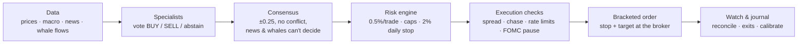
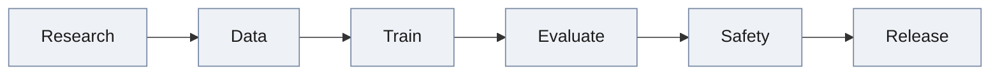
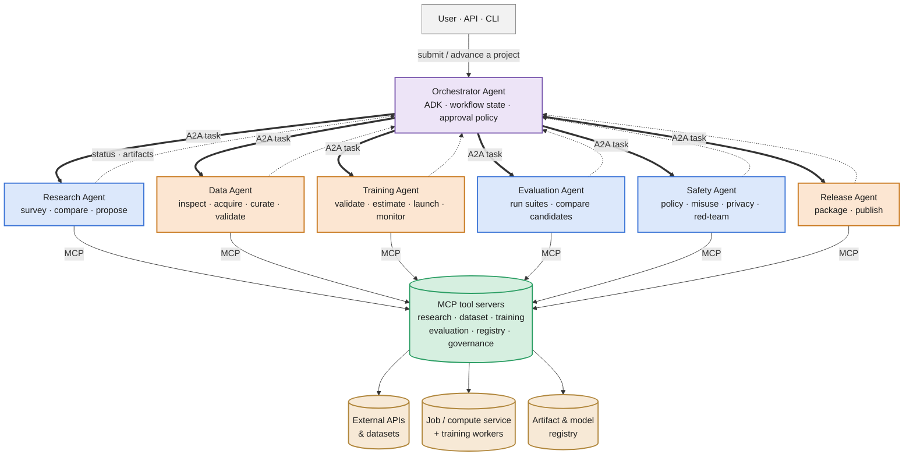

# Augur Tensors

Augur Tensors is a planned agentic AI R&D and model-training platform. Its goal
is to coordinate the full model lifecycle while keeping expensive, destructive,
or public actions behind explicit policy and human approval.

> **Status: pre-alpha.** Two parts exist today:
>
> 1. **A multi-asset trading system with a web dashboard** (`src/`, `providers/`,
>    `agents/augur_agents/trading/`, `ui/`): deterministic specialists, a
>    consensus layer, a rule-based risk engine, bracketed orders through Alpaca
>    (paper by default), politics/economics news and whale-flow intel. See
>    [Trading dashboard](#trading-dashboard) below and the in-app **How it works**
>    page.
> 2. **The agent layer** in [`agents/`](agents/) — five ADK agents wired over A2A,
>    with a lifecycle state machine and a code-enforced approval gate
>    ([`agents/README.md`](agents/README.md)). Its *tools* return realistic mock
>    data for now; the MCP capability servers, a real job manager, the
>    persistence schema, and the control plane below are still the target
>    architecture.
>
> The distributed-training kit (`dist_kit/`) referenced in older docs and in
> `pyproject.toml` is not in this repository.

## Trading dashboard

```bash
uv sync                                   # Python dependencies
cp .env.example .env                      # add keys, or leave blank for demo mode
uv run python src/dashboard_api.py        # API on http://127.0.0.1:8000
npm --prefix ui install && npm --prefix ui run dev   # UI on http://localhost:5173
```

With no keys it runs a simulated demo book. With Alpaca **paper** keys it trades
practice money. Live trading needs `TRADING_MODE=live`, `ALPACA_PAPER=false`
*and* typing `REAL MONEY` on every order.

How a trade happens (each step can say no):



| Page | What it shows |
|---|---|
| Markets | Live scan of crypto, gold, silver, oil and the S&P 500 with each specialist's vote and the reasons for "no trade" |
| News & whales | Policy-uncertainty percentile, news tone by theme, last FOMC release, USDT/ETH exchange flows and the largest transfers |
| Safety | Kill switch (flattens everything), halt/resume, the risk rules |
| How it works | The pipeline step by step and a playground running the real consensus arithmetic |

Data sources: Alpaca (prices, orders), FRED (real yields, policy uncertainty),
GDELT (news tone, no key), the Federal Reserve press feed (no key), and a public
Ethereum RPC node (whale flows, watch-only wallets, no key). The evidence behind
each choice is in
[`docs/RESEARCH_2026_10_STRATEGY_REVIEW.md`](docs/RESEARCH_2026_10_STRATEGY_REVIEW.md).

Tests:

```bash
uv run pytest agents/tests tests          # ~350 tests, offline
npm --prefix ui run build && npm --prefix ui run lint
```

## Agent platform (target architecture)

The intended lifecycle is a straight pipeline, each stage gated by policy and
human approval before the next one starts:




## Architecture decisions

Augur Tensors uses three complementary layers:

- **Google Agent Development Kit (ADK)** implements each agent and deterministic
  or agent-directed workflows.
- **Agent2Agent Protocol (A2A)** connects independently deployed agents. Agent
  Cards advertise skills; messages start or continue work; long-running work is
  represented by tasks, status updates, and artifacts.
- **Model Context Protocol (MCP)** gives an agent narrowly scoped tools and
  resources. MCP is the agent-to-tool boundary, not the agent-to-agent bus.

This separation is deliberate: orchestration stays in ADK, cross-service agent
collaboration uses A2A, and side effects such as downloading data, launching GPU
jobs, reading metrics, or publishing models are performed through MCP tools.

Official references:

- [ADK documentation](https://adk.dev/)
- [A2A Protocol](https://a2a-protocol.org/latest/)
- [Model Context Protocol](https://modelcontextprotocol.io/docs/learn/architecture)

## Target system



Read the arrows by weight: **thick = A2A** (the orchestrator handing a stage to
a specialist), **thin = MCP** (a tool reaching a backend), **dotted =
status/artifacts flowing back**.

**In plain terms:**

- **Orchestrator** — owns lifecycle coordination and holds no unrestricted
  infrastructure credentials itself; it delegates every side effect to a
  specialist over A2A and merges what comes back.
- **Blue (read) agents — Research, Evaluation, Safety** — survey, benchmark,
  and audit; none of them mutate external state on their own.
- **Orange (write) agents — Data, Training, Release** — the ones that acquire
  or publish a dataset, launch a paid GPU job, or publish a model; every one
  of these paths is a governed MCP tool call, gated by the approval policy in
  [Human approval and governance](#human-approval-and-governance).
- **MCP tool servers** — the only path from an agent to a real side effect.
  Each specialist gets only the tools its role needs (see
  [MCP boundary](#mcp-boundary)).
- **External APIs & datasets / Job or compute service / Artifact & model
  registry** — the systems MCP tools actually reach: source data and model
  hubs, the GPU job backend (planned), and the model/dataset
  registry a release publishes to.

### Planned agents

| Agent | A2A skills | Main outputs |
|---|---|---|
| Orchestrator | Create project, advance/cancel workflow, request approval | Workflow record, decision log |
| Research | Survey literature, compare architectures, propose experiments | Research brief, experiment proposals |
| Data | Inspect, acquire, curate, and validate datasets | Versioned dataset manifest and quality report |
| Training | Validate and estimate a run, launch/monitor/cancel/resume it | Training job, checkpoints, metrics, provenance |
| Evaluation | Execute benchmark suites and compare candidates | Versioned evaluation report |
| Safety | Run policy, misuse, privacy, and red-team suites | Safety report and release recommendation |
| Release | Package and publish an approved candidate | Signed release manifest and registry reference |

Agents exchange versioned structured contracts rather than machine-local paths.
The initial contracts will include `ProjectSpec`, `DatasetManifest`,
`TrainingPlan`, `TrainingJob`, `ModelArtifact`, `EvaluationReport`,
`SafetyReport`, and `ReleaseDecision`.

### A2A boundary

Every remotely deployed specialist will expose a standards-compliant Agent Card
at `/.well-known/agent-card.json` and support the A2A task lifecycle. Streaming
status and artifacts will be used for long-running training and evaluation.

A2A is not the durable event store. Workflow/task metadata, approvals, and audit
records will be persisted separately. If an internal event broker is introduced,
it remains an implementation detail rather than a replacement for A2A.

### MCP boundary

The first MCP servers should be capability-oriented rather than agent-oriented:

- `research-mcp`: paper search and metadata retrieval.
- `dataset-mcp`: dataset inspection, download, validation, curation, and
  manifest creation.
- `training-mcp`: config validation, cost estimation, job submission, status,
  logs, cancellation, checkpoint listing, and resume.
- `evaluation-mcp`: benchmark execution and report retrieval.
- `registry-mcp`: artifact metadata, model packaging, and controlled publishing.
- `governance-mcp`: approval requests, policy checks, and audit records.

Read-only tools and mutating tools must be distinguishable in both code and
policy. Training launch, dataset publication, destructive cancellation, and
model release require approval tokens that are scoped to a concrete action.

## Current repository

```text
augur/
|-- pyproject.toml  uv.lock     # uv workspace root (member: agents/)
|-- .env.example                # every key Augur can use; all optional
|-- src/
|   |-- dashboard_api.py        # FastAPI + WebSocket server behind the UI
|   |-- config.py               # typed settings, live-trading safety check
|   |-- integrations.py         # the Integrations page's registry
|   `-- technical_indicators.py
|-- providers/                  # broker / data adapters (no strategy logic)
|   |-- base.py                 # ExecutionProvider contract, DataUnavailable
|   |-- stocks_alpaca.py  crypto_binance.py  market_data.py
|   |-- fred.py  news.py        # macro series; GDELT tone, EPU, Fed releases
|   `-- wallets.py  whales.py   # watch-only balances; exchange whale flows
|-- agents/augur_agents/
|   |-- trading/                # specialists, consensus, risk, execution, guard,
|   |                           # backtest, calibration, journal, monitor
|   `-- orchestrator/ research/ data/ training/ evaluation/   # ADK agent layer
|-- ui/                         # React + Vite dashboard
|-- tests/                      # dashboard, providers, invariants, fake-news, black-box
|-- agents/tests/               # agent layer and trading core
|-- scripts/                    # setup wizard, demo, connection checks
`-- docs/
```

## Agent layer setup

```bash
uv run pytest agents/tests                 # offline
cp .env.example .env                       # fill in an LLM provider key
uv run python -m augur_agents serve all    # the four worker A2A servers
uv run adk api_server --with_ui --port 8000   --session_service_uri "sqlite:///augur_agents.db" agents/augur_agents/orchestrator
```

Still architecture only: the MCP capability servers (`dataset-mcp`,
`training-mcp`, `evaluation-mcp`, `governance-mcp`), a real job manager and
scheduler, the workflow / approval / audit database schema, and the Safety and
Release agents.

## Human approval and governance

The following are mandatory approval boundaries in the target system:

| Action | Default policy |
|---|---|
| Read public metadata or validate a local configuration | Automatic |
| Download an allow-listed dataset/model | Automatic within quota |
| Write or publish a curated dataset | Human approval |
| Launch a paid GPU job | Human approval above configurable cost/risk limits |
| Cancel a running job or delete artifacts | Human approval unless pre-authorized |
| Modify production code or infrastructure | Human approval |
| Publish a model or dataset publicly | Human approval, safety pass required |

An approval records the exact action, inputs, estimated cost, expiration, actor,
and resulting artifacts. A free-form chat response is not an authorization
token.

## License

A license has not been added yet. Do not assume MIT or another license until a
`LICENSE` file is committed.


